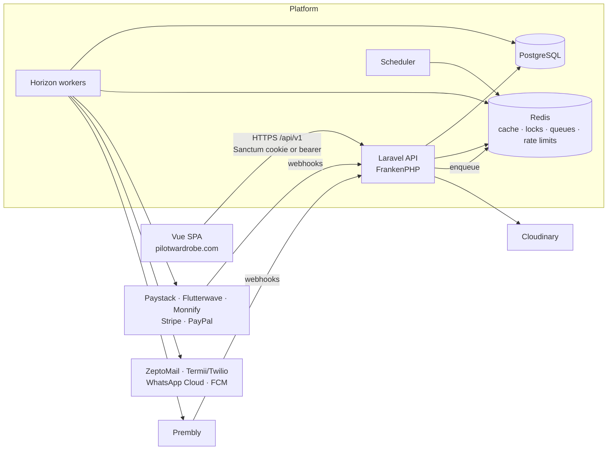
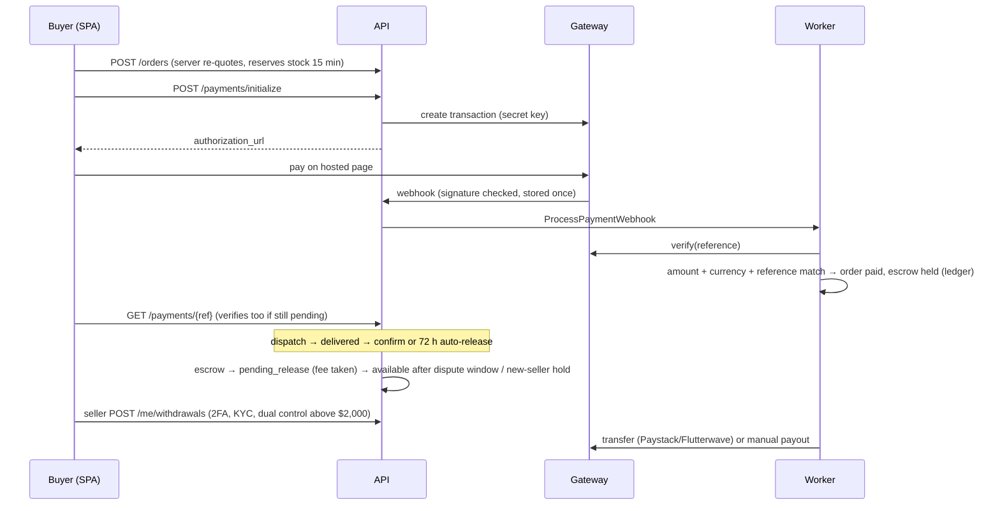

# Backend architecture

The Pilotwardrobe API is a Laravel 13 (PHP 8.5) application serving the Vue SPA at `/api/v1`. It runs on PostgreSQL and Redis, uses Horizon for queues, and calls external providers for payments, payouts, e-mail, SMS, WhatsApp, push, media and KYC. This document explains how the code is organised and how a request flows through it. Related docs: [database-schema.md](database-schema.md), [integrations.md](integrations.md), [security.md](security.md), [deployment.md](deployment.md), [backend-implementation-notes.md](backend-implementation-notes.md).

## System context



The API process handles HTTP only. Anything slow or external that the response does not depend on (notifications, refunds, payouts, KYC checks, exports, broadcasts, webhook processing) runs on queues. Payment initialisation and verification are the exception: they call the gateway synchronously because the SPA needs the answer immediately.

## Code layout

```
app/
  Http/
    Controllers/Api/V1/<Area>/   thin controllers: validate → call a service → present
    Controllers/Webhooks/        payment, KYC and WhatsApp webhooks (verify, store, enqueue)
    Middleware/                  request id, locale, security headers, account checks, permissions, idempotency, maintenance
    Requests/                    Form Requests for the larger payloads (auth, listings, profile)
    Resources/                   response presenters (ListingResource, OrderResource, Admin/AdminPresenter, …)
  Services/<Domain>/             business logic and transactions (OrderService, PaymentService, WalletService, …)
  Actions/                       single-purpose use cases (RegisterUser, DeleteAccount)
  Integrations/<Kind>/           provider adapters behind contracts (PaymentGateway, TransferProvider, SmsSender, …)
  Jobs/<Domain>/                 queued work
  Models/                        Eloquent models (prefixed string ids, casts, relations, small helpers)
  Enums/                         backed enums; state machines declare their transitions here
  Support/                       Money, prefixed ids, state-machine trait, API response helpers
  Console/Commands/              sweeps, status recording, pruning, doc generators
config/
  platform.php                   marketplace rules and defaults (escrow timings, limits, fees, markets, gateways)
  permissions.php                permission catalogue, role defaults, staff role bundles, admin matrix
  notifications.php              every notification template and its channels
  services.php, kyc.php          provider credentials and drivers (env only)
routes/
  api.php, admin.php             /api/v1 and /api/v1/admin
  webhooks.php, system.php       /api/v1/webhooks/*, /health, signed download routes
  console.php                    scheduler
```

### Layer rules

- **Controllers** validate input (inline `$request->validate()` or a Form Request), load records scoped to the caller, call one service method and return `ApiResponse::ok()` with a presenter. They hold no business rules.
- **Services** own business rules and transactions. Every state change goes through a service: it locks the rows it changes, checks the transition is legal via the enum state machine, writes events and audit entries, and schedules notifications with `DB::afterCommit` so nothing is sent for a rolled-back transaction.
- **Integrations** are the only code that talks to third parties. Each kind has a contract, one adapter per provider, a fake or log adapter for development, and typed result objects. Adapters raise `ProviderException` marked *transient* (retry) or *permanent* (do not retry).
- **Presenters** build the exact wire format from `docs/api-payloads/`. Money is always `Money::toArray()`; dates are ISO-8601 UTC with `Z`.
- **Never trusted from the client:** user id, role, permissions, prices, totals, fees, discounts, payment and transaction status, verification status. All of them are derived on the server.

## Request lifecycle

1. **Global middleware:** `AssignRequestId` (accepts or creates `X-Request-Id`, adds it to the log context and the response), trusted proxies, CORS, `SecurityHeaders`.
2. **API group:** Sanctum stateful handling (cookie sessions for `SANCTUM_STATEFUL_DOMAINS`), the `api` throttle (120/min), `SetRequestLocale` (`Accept-Language`) and `CheckMaintenanceWindow`, which returns 503 `MAINTENANCE` during a scheduled window and exempts staff, auth, health and webhooks.
3. **Route middleware:** `auth:sanctum` → `account` (`EnsureAccountUsable`: rejects suspended users and revoked, expired or idle staff sessions; impersonation is read-only) → `staff` → `perm:x` (effective permission) → named throttles → `idempotent`.
4. **Controller → service → presenter.**
5. **Errors:** every exception is rendered by `ApiExceptionRenderer` into `{ success: false, message, code, errors?, meta? }`. Validation → 422 with request field names; model not found → 404; illegal transition → 409 `INVALID_STATE_TRANSITION`; throttling → 429 with `meta.retry_after`. Unexpected errors → 500 `SERVER_ERROR` with a generic message; details go to the log with the request id, never to the client.

## Domain model in brief

| Area | Core records | Service |
|---|---|---|
| Identity | users, staff_roles, permission overrides, auth_sessions, trusted/known devices, passkeys | `Auth/*` (SessionManager, TwoFactorService, StaffAuthenticator, PermissionResolver) |
| Catalogue | categories (size charts, Fit Kit maps), listings (full-text search vector), favourites, promotions | `Catalogue/*` (ListingSearch, ListingService, FitMatcher, ShippingOptions) |
| Trading | offers, swaps, cart, orders and order items, reviews | `Trading/*`, `Orders/*`, `Reviews/*` |
| Money | payments, refunds, webhook_events, wallets, ledger_entries, payouts, approval_requests | `Payments/PaymentService`, `Wallet/WalletService`, `Payouts/PayoutService`, `Admin/ApprovalService` |
| Trust & safety | kyc_verifications, aviator_credentials, disputes, reports, audit_logs | `Verification/KycService`, `Disputes/DisputeService`, `Audit/AuditLogger` |
| Community | conversations, messages, notifications and deliveries | `Messaging/ConversationService`, `Notifications/NotificationService` |
| Platform | platform_settings, maintenance windows, status checks, CMS pages, broadcasts, exports | `Platform/*`, `Admin/BroadcastService` |

### State machines

Listing, offer, swap, order, escrow, payment, dispute, KYC, payout, user status and aviator credential are backed enums using the `HasTransitions` trait. Each enum declares its allowed transitions, and services call `$status->assertCanTransitionTo($next)`, which throws 409 for anything else. The transition diagrams are in [frontend-backend-handoff.md §8](frontend-backend-handoff.md#8-state-machines). Time-based transitions (unpaid order expiry, offer and swap expiry, auto-release, settlement, dispute escalation, promotion expiry, KYC document expiry) run in `marketplace:sweep` on the scheduler. Every sweep is idempotent and safe to re-run.

### Money flow



Wallet buckets and ledger rules: [backend-implementation-notes.md D5](backend-implementation-notes.md#data-and-money).

## Cross-cutting concerns

| Concern | Implementation |
|---|---|
| Authentication | Sanctum: cookie sessions for the SPA, bearer tokens for other clients. Every login creates an `auth_sessions` row so sessions can be listed and revoked (`/me/security`). |
| Authorisation | Permission strings from `config/permissions.php` resolved per user (`PermissionResolver`, cached by `permissions_version`), exposed as gate abilities and checked by the `perm:` middleware. Ownership is enforced by caller-scoped queries (404 for other users' records) and re-checked in services. |
| Idempotency | `IdempotentRequest` stores the response per user + key + route for 24 h. A replay returns the stored response; the same key with a different body → 409; a concurrent duplicate → 409. Webhooks are deduplicated on `(provider, event_id)`, and wallet movements on a unique marker. |
| Audit | `AuditLogger` writes actor, action, target, before/after, IP, user agent and request id for every admin mutation and every security event. Rows are immutable (database trigger). |
| Notifications | `NotificationService::notify()` renders a template from `config/notifications.php`, writes the in-app notification, applies the user's channel preferences and creates one `notification_deliveries` row per channel (e-mail, SMS, WhatsApp, push). A `DeliverNotification` job is queued after commit. A unique `dedupe_key` per event stops the same notification being created twice. |
| Caching | Redis. Only scalars and arrays are cached (D20). Hot keys: permissions, settings, commission rules, home rails, category tree, exchange rates. Keys are invalidated on write. |
| Locks | `lockForUpdate()` inside transactions for stock, wallets, payouts, disputes, offers and swaps; `Cache::lock` around idempotent requests, payment verification and each notification delivery; `withoutOverlapping()` + `onOneServer()` for scheduled sweeps. |
| Observability | `X-Request-Id` on every response and in the log context. Logs go to stderr in containers (`LOG_CHANNEL=stderr`; set `LOG_STDERR_FORMATTER=Monolog\Formatter\JsonFormatter` for JSON). `/health` checks the database, cache and queue and never reveals secrets. Horizon dashboard and long-wait alerts. `status_checks` history feeds the public status page. |
| Configuration | Secrets only in env (`.env.example` documents every key with placeholders). Business defaults in `config/platform.php`, overridable at runtime through `platform_settings` (with dual control where marked). |

## Testing

`php artisan test` runs against a real PostgreSQL database (`pilotwardrobe_test`) because the schema relies on PostgreSQL features (partial indexes, `tsvector`, `jsonb`, check constraints, triggers).

- `tests/Feature`: HTTP-level tests per area (auth, catalogue, selling, checkout and payments, offers/swaps/wallet, disputes and messaging, admin control tower, platform behaviour).
- `tests/Unit`: money arithmetic and state machines.
- `tests/Integration`: provider adapters against faked HTTP. This covers signature verification, request shape and response mapping for each payment gateway, SMS failover, WhatsApp and push.
- `scripts/payload-audit.php`: replays all `docs/api-payloads` samples against a seeded database ([payload-compatibility-audit.md](payload-compatibility-audit.md)).

Stray HTTP calls fail the test (`Http::preventStrayRequests()`). Cache serialization is turned on in tests so that caching objects fails loudly. Static analysis: Larastan level 5 with no baseline. Code style: Pint.
