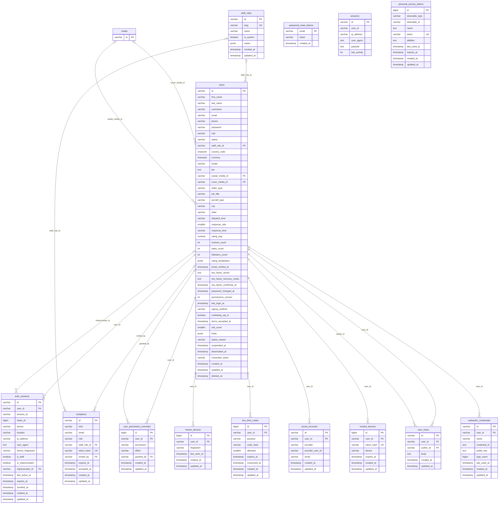
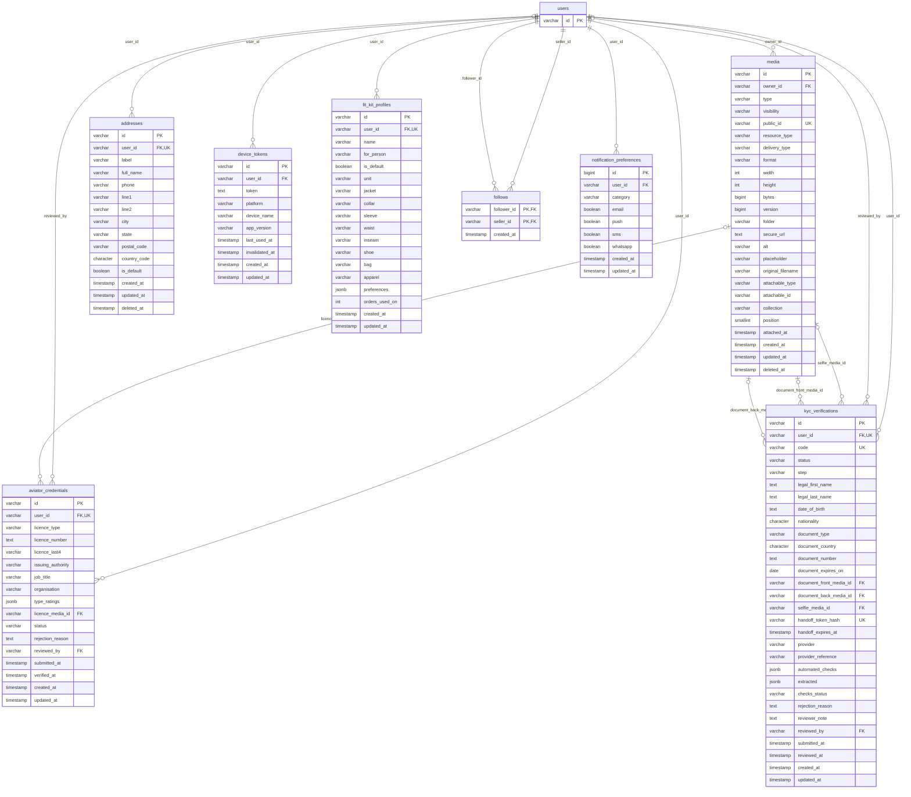
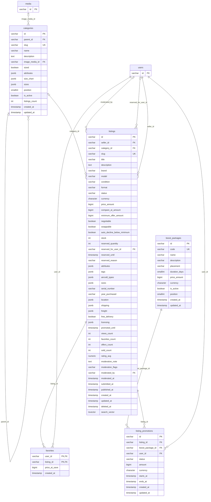
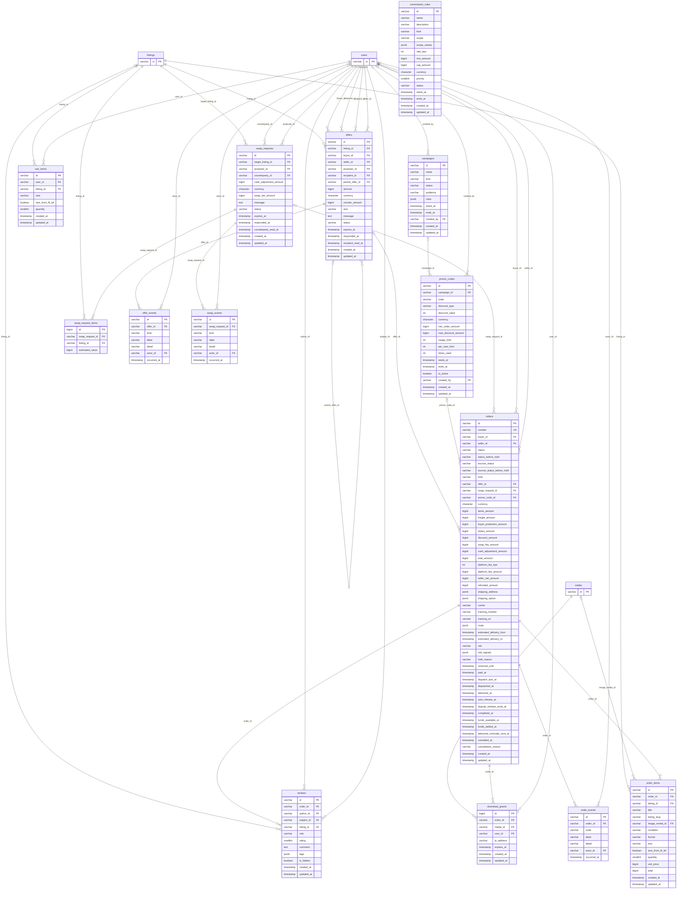
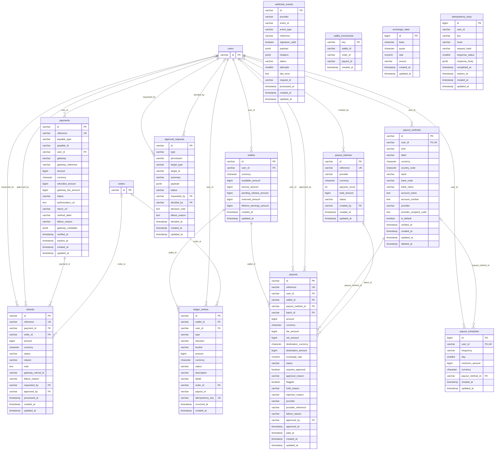
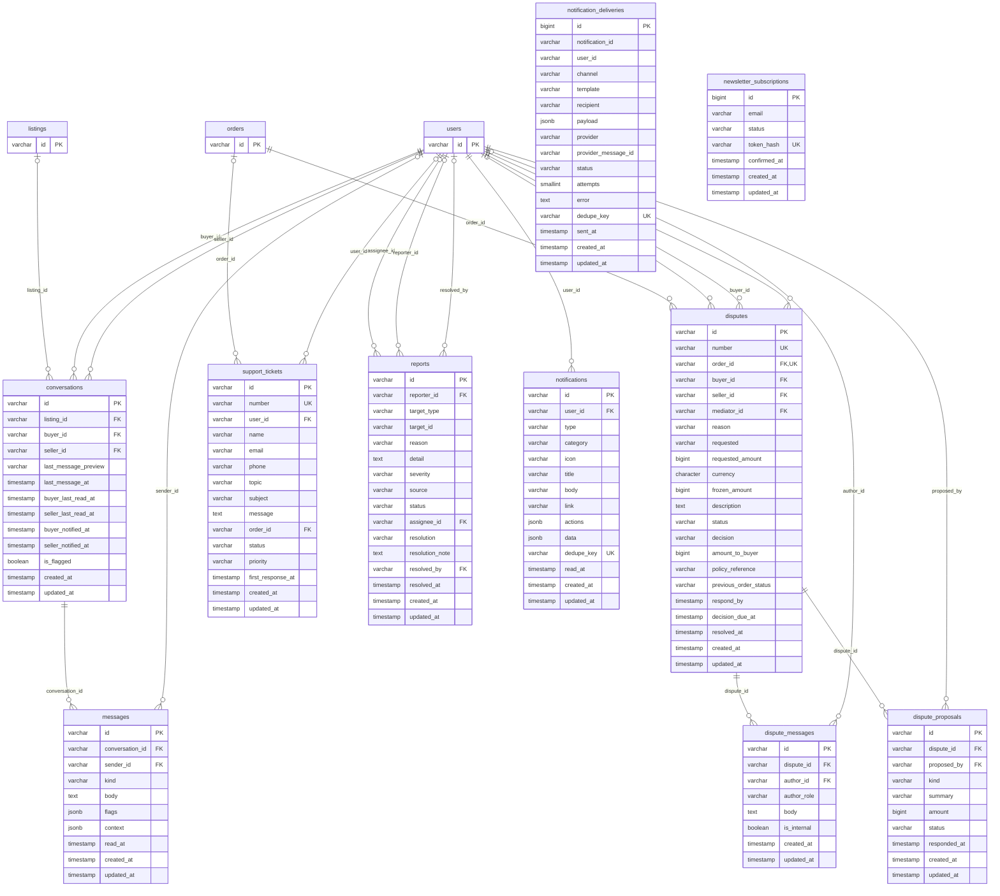
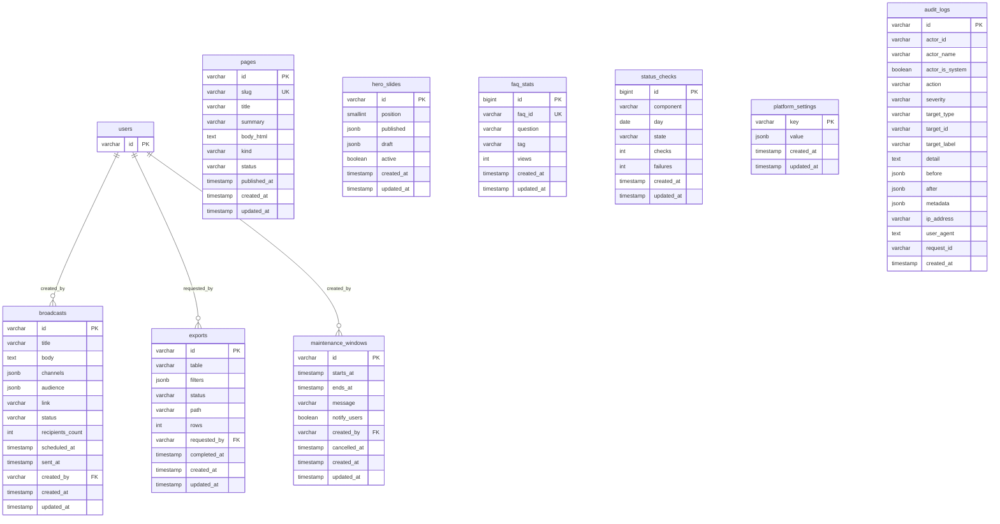

# Database schema

PostgreSQL 15+ (developed on 18). Generated from the migrated schema (`database/migrations`) on 2026-10-21; regenerate after schema changes. Model `@property` docblocks are regenerated with `php artisan dev:model-docs`.

## Conventions

- **Primary keys** are opaque prefixed strings: `usr_01j…` (prefix + lowercase ULID, `App\Support\Ids\HasPrefixedId`). They sort by creation time, are safe to expose, and never leak row counts. Framework tables keep their defaults.
- **Money** is `bigint` minor units in `*_amount` columns with a sibling `currency` (ISO 4217). Percentages are basis points (`*_bps`). No floats.
- **Timestamps** are `timestamp(0)` in UTC; the API serialises ISO-8601 with `Z`.
- **Enums** are `varchar` validated by PHP backed enums (`app/Enums`) and, where it matters, `CHECK` constraints.
- **JSON** uses `jsonb` (settings, payloads, snapshots, size charts).
- **Case-insensitive uniqueness** (emails, usernames) uses unique indexes on `lower(column)`.
- **Images are never stored in the database**; `media` holds Cloudinary public ids and dimensions only.
- **Sensitive identity data** (KYC names, DOB, document numbers, 2FA secrets) is encrypted at rest with Laravel encrypted casts.
- **Polymorphic columns** store short morph aliases (`user`, `listing`, `order`, …) from an enforced morph map.

**79 tables**, 121 foreign keys, 16 check constraints, 15 partial indexes, 2 guard triggers.

## Integrity rules enforced by the database

| Table | Rule | Definition |
|---|---|---|
| `addresses` | unique partial index `addresses_one_default` | `btree (user_id) WHERE (is_default AND (deleted_at IS NULL))` |
| `audit_logs` | trigger | `audit_logs_immutable (BEFORE DELETE)` |
| `audit_logs` | trigger | `audit_logs_immutable (BEFORE UPDATE)` |
| `conversations` | unique partial index `conversations_listing_parties_unique` | `btree (listing_id, buyer_id, seller_id) WHERE (listing_id IS NOT NULL)` |
| `disputes` | unique partial index `disputes_one_active_per_order` | `btree (order_id) WHERE ((status)::text = ANY ((ARRAY['open'::character varying, 'awaiting_seller'::character varying, 'under_review'::character varying, 'appealed'::character varying])::text[]))` |
| `fit_kit_profiles` | unique partial index `fit_kit_one_default` | `btree (user_id) WHERE is_default` |
| `ledger_entries` | check `ledger_amount_positive` | `CHECK ((amount > 0))` |
| `ledger_entries` | trigger | `ledger_entries_guard (BEFORE DELETE)` |
| `ledger_entries` | trigger | `ledger_entries_guard (BEFORE UPDATE)` |
| `listings` | check `listings_status_check` | `CHECK (((status)::text = ANY ((ARRAY['draft'::character varying, 'pending_review'::character varying, 'needs_changes'::character varying, 'active'::character varying, 'paused'::character varying, 'reserved'::character varying, 'unavailable'::character varying, 'sold'::character varying, 'swapped'::character varying, 'archived'::character varying, 'rejected'::character varying, 'removed'::character varying])::text[])))` |
| `listings` | check `listings_price_nonneg` | `CHECK (((price_amount IS NULL) OR (price_amount >= 0)))` |
| `listings` | check `listings_reserved_le_stock` | `CHECK ((reserved_quantity <= stock))` |
| `listings` | partial index `listings_public_idx` | `btree (published_at DESC) WHERE (((status)::text = ANY ((ARRAY['active'::character varying, 'reserved'::character varying])::text[])) AND (deleted_at IS NULL))` |
| `listings` | partial index `listings_promoted_idx` | `btree (promoted_until) WHERE (promoted_until IS NOT NULL)` |
| `media` | partial index `media_unattached_idx` | `btree (created_at) WHERE ((attachable_id IS NULL) AND (deleted_at IS NULL))` |
| `notifications` | partial index `notifications_unread_idx` | `btree (user_id) WHERE (read_at IS NULL)` |
| `offers` | check `offers_amount_positive` | `CHECK ((amount > 0))` |
| `offers` | unique partial index `offers_one_pending_per_buyer` | `btree (listing_id, buyer_id) WHERE ((status)::text = 'pending'::text)` |
| `orders` | check `orders_status_check` | `CHECK (((status)::text = ANY ((ARRAY['pending_payment'::character varying, 'paid'::character varying, 'awaiting_dispatch'::character varying, 'in_transit'::character varying, 'out_for_delivery'::character varying, 'delivered'::character varying, 'completed'::character varying, 'cancelled'::character varying, 'disputed'::character varying, 'refunded'::character varying, 'partially_refunded'::character varying, 'on_hold'::character varying])::text[])))` |
| `orders` | check `orders_escrow_check` | `CHECK (((escrow_status)::text = ANY ((ARRAY['not_funded'::character varying, 'held'::character varying, 'frozen'::character varying, 'on_hold'::character varying, 'releasing'::character varying, 'released'::character varying, 'refunded'::character varying])::text[])))` |
| `orders` | check `orders_total_nonneg` | `CHECK (((total_amount >= 0) AND (refunded_amount >= 0) AND (refunded_amount <= total_amount)))` |
| `orders` | partial index `orders_pending_expiry_idx` | `btree (reserved_until) WHERE ((status)::text = 'pending_payment'::text)` |
| `orders` | partial index `orders_auto_release_idx` | `btree (auto_release_at) WHERE ((status)::text = 'delivered'::text)` |
| `orders` | partial index `orders_funds_pending_idx` | `btree (funds_available_at) WHERE ((funds_settled_at IS NULL) AND (funds_available_at IS NOT NULL))` |
| `payments` | check `payments_amount_positive` | `CHECK (((amount > 0) AND (refunded_amount >= 0) AND (refunded_amount <= amount)))` |
| `payments` | unique partial index `payments_gateway_reference_unique` | `btree (gateway, gateway_reference) WHERE (gateway_reference IS NOT NULL)` |
| `payments` | unique partial index `payments_one_open_per_gateway` | `btree (payable_type, payable_id, gateway) WHERE ((status)::text = ANY ((ARRAY['pending'::character varying, 'processing'::character varying])::text[]))` |
| `payout_methods` | unique partial index `payout_methods_one_default` | `btree (user_id) WHERE (is_default AND (deleted_at IS NULL))` |
| `payouts` | check `payouts_amount_positive` | `CHECK (((amount > 0) AND (net_amount >= 0)))` |
| `refunds` | check `refunds_amount_positive` | `CHECK ((amount > 0))` |
| `reviews` | check `reviews_rating_range` | `CHECK (((rating >= 1) AND (rating <= 5)))` |
| `user_permission_overrides` | check `upo_effect_check` | `CHECK (((effect)::text = ANY ((ARRAY['grant'::character varying, 'revoke'::character varying])::text[])))` |
| `users` | check `users_role_check` | `CHECK (((role)::text = ANY ((ARRAY['user'::character varying, 'aviator'::character varying, 'admin'::character varying, 'super_admin'::character varying])::text[])))` |
| `users` | check `users_status_check` | `CHECK (((status)::text = ANY ((ARRAY['active'::character varying, 'restricted'::character varying, 'suspended'::character varying, 'deactivated'::character varying, 'pending_verification'::character varying])::text[])))` |
| `wallets` | check `wallets_nonneg` | `CHECK (((available_amount >= 0) AND (escrow_amount >= 0) AND (reserved_amount >= 0) AND (pending_release_amount >= 0)))` |

`audit_logs` rows cannot be updated or deleted. `ledger_entries` amounts are immutable (corrections are new, reversing entries).

## Identity & access

Accounts, staff roles, sessions, 2FA, passkeys and invitations.

| Table | Columns | Foreign keys (on delete) | Indexes |
|---|---|---|---|
| `users` | 48 | `avatar_media_id` → `media` (set null), `cover_media_id` → `media` (set null), `staff_role_id` → `staff_roles` (restrict) | `users_created_at_index`, **`users_email_lower_unique`**, `users_role_status_index`, `users_staff_role_id_index`, **`users_username_lower_unique`** |
| `staff_roles` | 7 | — | **`staff_roles_slug_unique`** |
| `user_permission_overrides` | 7 | `granted_by` → `users` (restrict), `user_id` → `users` (cascade) | **`user_permission_overrides_user_id_permission_unique`** |
| `social_accounts` | 7 | `user_id` → `users` (cascade) | **`social_accounts_provider_provider_user_id_unique`**, **`social_accounts_user_id_provider_unique`** |
| `password_reset_tokens` | 3 | — | — |
| `sessions` | 6 | — | `sessions_last_activity_index`, `sessions_user_id_index` |
| `personal_access_tokens` | 10 | — | `personal_access_tokens_expires_at_index`, **`personal_access_tokens_token_unique`**, `personal_access_tokens_tokenable_type_tokenable_id_index` |
| `one_time_codes` | 9 | `user_id` → `users` (cascade) | `one_time_codes_user_id_purpose_consumed_at_index` |
| `auth_sessions` | 17 | `impersonator_id` → `users` (restrict), `user_id` → `users` (cascade) | `auth_sessions_session_id_index`, `auth_sessions_token_id_index`, `auth_sessions_user_id_revoked_at_index` |
| `trusted_devices` | 7 | `user_id` → `users` (cascade) | **`trusted_devices_token_hash_unique`** |
| `known_devices` | 6 | `user_id` → `users` (cascade) | **`known_devices_user_id_fingerprint_unique`** |
| `webauthn_credentials` | 9 | `user_id` → `users` (cascade) | **`webauthn_credential_id_unique`** |
| `invitations` | 11 | `invited_by` → `users` (restrict), `staff_role_id` → `staff_roles` (restrict) | `invitations_email_index`, **`invitations_token_hash_unique`** |
| `user_notes` | 6 | `author_id` → `users` (restrict), `user_id` → `users` (cascade) | — |

## Profile, media & verification

Uploaded media metadata (files live in Cloudinary), addresses, Fit Kit, KYC and aviator credentials.

| Table | Columns | Foreign keys (on delete) | Indexes |
|---|---|---|---|
| `media` | 25 | `owner_id` → `users` (restrict) | `media_attachable_type_attachable_id_collection_position_index`, `media_owner_id_index`, **`media_public_id_unique`**, `media_unattached_idx` |
| `addresses` | 15 | `user_id` → `users` (cascade) | **`addresses_one_default`** |
| `fit_kit_profiles` | 18 | `user_id` → `users` (cascade) | **`fit_kit_one_default`** |
| `notification_preferences` | 9 | `user_id` → `users` (cascade) | **`notification_preferences_user_id_category_unique`** |
| `device_tokens` | 10 | `user_id` → `users` (cascade) | **`device_tokens_token_unique`** |
| `follows` | 3 | `follower_id` → `users` (cascade), `seller_id` → `users` (cascade) | `follows_seller_id_index` |
| `kyc_verifications` | 30 | `document_back_media_id` → `media` (restrict), `document_front_media_id` → `media` (restrict), `reviewed_by` → `users` (restrict), `selfie_media_id` → `media` (restrict), `user_id` → `users` (cascade) | **`kyc_verifications_code_unique`**, **`kyc_verifications_handoff_token_hash_unique`**, `kyc_verifications_status_submitted_at_index`, **`kyc_verifications_user_id_unique`** |
| `aviator_credentials` | 17 | `licence_media_id` → `media` (restrict), `reviewed_by` → `users` (restrict), `user_id` → `users` (cascade) | `aviator_credentials_status_index`, **`aviator_credentials_user_id_unique`** |

## Catalogue

Categories, listings (full-text `search_vector`), favourites and paid boosts.

| Table | Columns | Foreign keys (on delete) | Indexes |
|---|---|---|---|
| `categories` | 15 | `image_media_id` → `media` (restrict), `parent_id` → `categories` (set null) | `categories_parent_id_index`, **`categories_slug_unique`** |
| `listings` | 50 | `category_id` → `categories` (restrict), `moderated_by` → `users` (restrict), `reserved_for_user_id` → `users` (restrict), `seller_id` → `users` (restrict) | `listings_aircraft_types_idx`, `listings_category_id_index`, `listings_category_id_status_price_amount_index`, `listings_promoted_idx`, `listings_public_idx`, `listings_search_vector_idx`, `listings_seller_id_index`, `listings_seller_id_status_index`, **`listings_slug_unique`**, `listings_status_published_at_index` |
| `favorites` | 4 | `listing_id` → `listings` (cascade), `user_id` → `users` (cascade) | `favorites_listing_id_index` |
| `boost_packages` | 12 | — | **`boost_packages_code_unique`** |
| `listing_promotions` | 11 | `boost_package_id` → `boost_packages` (restrict), `listing_id` → `listings` (cascade), `user_id` → `users` (restrict) | `listing_promotions_status_ends_at_index` |

## Trading & orders

Offers, swaps, cart, pricing rules, orders and reviews.

| Table | Columns | Foreign keys (on delete) | Indexes |
|---|---|---|---|
| `offers` | 18 | `buyer_id` → `users` (restrict), `listing_id` → `listings` (cascade), `parent_offer_id` → `offers` (set null), `proposer_id` → `users` (restrict), `recipient_id` → `users` (restrict), `seller_id` → `users` (restrict) | **`offers_one_pending_per_buyer`**, `offers_proposer_id_status_index`, `offers_recipient_id_status_index`, `offers_status_expires_at_index` |
| `offer_events` | 7 | `actor_id` → `users` (restrict), `offer_id` → `offers` (cascade) | `offer_events_offer_id_occurred_at_index` |
| `swap_requests` | 14 | `counterparty_id` → `users` (restrict), `proposer_id` → `users` (restrict), `target_listing_id` → `listings` (restrict) | `swap_requests_counterparty_id_status_index`, `swap_requests_proposer_id_status_index`, `swap_requests_status_expires_at_index` |
| `swap_request_items` | 4 | `listing_id` → `listings` (restrict), `swap_request_id` → `swap_requests` (cascade) | **`swap_request_items_swap_request_id_listing_id_unique`** |
| `swap_events` | 7 | `actor_id` → `users` (restrict), `swap_request_id` → `swap_requests` (cascade) | — |
| `cart_items` | 8 | `listing_id` → `listings` (cascade), `user_id` → `users` (cascade) | **`cart_items_user_id_listing_id_unique`** |
| `campaigns` | 11 | `created_by` → `users` (restrict) | — |
| `promo_codes` | 17 | `campaign_id` → `campaigns` (restrict), `created_by` → `users` (restrict) | **`promo_codes_code_upper_unique`** |
| `commission_rules` | 16 | — | `commission_rules_kind_status_index` |
| `orders` | 51 | `buyer_id` → `users` (restrict), `offer_id` → `offers` (restrict), `promo_code_id` → `promo_codes` (restrict), `seller_id` → `users` (restrict), `swap_request_id` → `swap_requests` (restrict) | `orders_auto_release_idx`, `orders_buyer_id_index`, `orders_escrow_status_index`, `orders_funds_pending_idx`, **`orders_number_unique`**, `orders_pending_expiry_idx`, `orders_seller_id_index`, `orders_status_created_at_index`, `orders_swap_request_id_index` |
| `order_items` | 15 | `image_media_id` → `media` (restrict), `listing_id` → `listings` (restrict), `order_id` → `orders` (cascade) | — |
| `order_events` | 7 | `actor_id` → `users` (restrict), `order_id` → `orders` (cascade) | `order_events_order_id_occurred_at_index` |
| `download_grants` | 8 | `media_id` → `media` (restrict), `order_id` → `orders` (cascade), `user_id` → `users` (restrict) | — |
| `reviews` | 12 | `author_id` → `users` (restrict), `listing_id` → `listings` (restrict), `order_id` → `orders` (restrict), `subject_id` → `users` (restrict) | `reviews_listing_id_index`, **`reviews_order_id_author_id_unique`**, `reviews_subject_id_index` |

## Money

Payments, refunds, webhooks, wallets with an append-only ledger, payouts, FX, idempotency and dual control.

| Table | Columns | Foreign keys (on delete) | Indexes |
|---|---|---|---|
| `payments` | 21 | `user_id` → `users` (restrict) | **`payments_gateway_reference_unique`**, **`payments_one_open_per_gateway`**, `payments_payable_type_payable_id_index`, **`payments_reference_unique`**, `payments_status_created_at_index`, `payments_user_id_index` |
| `refunds` | 16 | `approved_by` → `users` (restrict), `order_id` → `orders` (restrict), `payment_id` → `payments` (restrict), `requested_by` → `users` (restrict) | `refunds_order_id_index`, **`refunds_reference_unique`** |
| `webhook_events` | 15 | — | **`webhook_events_provider_event_id_unique`**, `webhook_events_reference_index`, `webhook_events_status_created_at_index` |
| `wallets` | 10 | `user_id` → `users` (cascade) | **`wallets_user_id_currency_unique`** |
| `ledger_entries` | 16 | `order_id` → `orders` (restrict), `user_id` → `users` (restrict), `wallet_id` → `wallets` (restrict) | **`ledger_entries_idempotency_key_unique`**, `ledger_entries_order_id_index`, `ledger_entries_payout_id_index`, `ledger_entries_user_id_index`, `ledger_entries_user_id_occurred_at_index` |
| `wallet_movements` | 5 | — | `wallet_movements_order_id_index`, `wallet_movements_wallet_id_index` |
| `payout_methods` | 18 | `user_id` → `users` (cascade) | **`payout_methods_one_default`** |
| `payout_schedules` | 9 | `payout_method_id` → `payout_methods` (restrict), `user_id` → `users` (cascade) | **`payout_schedules_user_id_unique`** |
| `payout_batches` | 10 | `created_by` → `users` (restrict) | **`payout_batches_reference_unique`** |
| `payouts` | 27 | `approved_by` → `users` (restrict), `batch_id` → `payout_batches` (restrict), `payout_method_id` → `payout_methods` (restrict), `user_id` → `users` (restrict), `wallet_id` → `wallets` (restrict) | **`payouts_reference_unique`**, `payouts_status_created_at_index`, `payouts_user_id_index` |
| `exchange_rates` | 7 | — | **`exchange_rates_base_quote_unique`** |
| `idempotency_keys` | 11 | — | `idempotency_keys_expires_at_index`, **`idempotency_keys_user_id_key_route_unique`** |
| `approval_requests` | 15 | `decided_by` → `users` (restrict), `requested_by` → `users` (restrict) | `approval_requests_status_type_index` |

## Community, disputes & notifications

Messaging, disputes, reports, support and the notification centre.

| Table | Columns | Foreign keys (on delete) | Indexes |
|---|---|---|---|
| `conversations` | 13 | `buyer_id` → `users` (restrict), `listing_id` → `listings` (restrict), `seller_id` → `users` (restrict) | `conversations_buyer_id_last_message_at_index`, **`conversations_listing_parties_unique`**, `conversations_seller_id_last_message_at_index` |
| `messages` | 10 | `conversation_id` → `conversations` (cascade), `sender_id` → `users` (restrict) | `messages_conversation_id_created_at_index` |
| `disputes` | 22 | `buyer_id` → `users` (restrict), `mediator_id` → `users` (restrict), `order_id` → `orders` (restrict), `seller_id` → `users` (restrict) | `disputes_buyer_id_index`, **`disputes_number_unique`**, **`disputes_one_active_per_order`**, `disputes_seller_id_index`, `disputes_status_created_at_index` |
| `dispute_messages` | 8 | `author_id` → `users` (restrict), `dispute_id` → `disputes` (cascade) | `dispute_messages_dispute_id_created_at_index` |
| `dispute_proposals` | 10 | `dispute_id` → `disputes` (cascade), `proposed_by` → `users` (restrict) | — |
| `reports` | 16 | `assignee_id` → `users` (restrict), `reporter_id` → `users` (restrict), `resolved_by` → `users` (restrict) | `reports_status_severity_index`, `reports_target_type_target_id_index` |
| `support_tickets` | 15 | `order_id` → `orders` (restrict), `user_id` → `users` (restrict) | **`support_tickets_number_unique`**, `support_tickets_status_created_at_index` |
| `notifications` | 14 | `user_id` → `users` (cascade) | **`notifications_dedupe_key_unique`**, `notifications_unread_idx`, `notifications_user_id_created_at_index` |
| `notification_deliveries` | 16 | — | **`notification_deliveries_dedupe_key_unique`**, `notification_deliveries_notification_id_index`, `notification_deliveries_provider_message_id_index`, `notification_deliveries_user_id_index` |
| `newsletter_subscriptions` | 7 | — | **`newsletter_email_lower_unique`**, **`newsletter_subscriptions_token_hash_unique`** |

## Platform & content

CMS pages, home rails, status history, broadcasts, exports, maintenance, settings and the audit log.

| Table | Columns | Foreign keys (on delete) | Indexes |
|---|---|---|---|
| `pages` | 10 | — | **`pages_slug_unique`** |
| `hero_slides` | 7 | — | — |
| `faq_stats` | 7 | — | **`faq_stats_faq_id_unique`** |
| `status_checks` | 8 | — | **`status_checks_component_day_unique`** |
| `broadcasts` | 13 | `created_by` → `users` (restrict) | — |
| `exports` | 10 | `requested_by` → `users` (restrict) | — |
| `maintenance_windows` | 9 | `created_by` → `users` (restrict) | `maintenance_windows_starts_at_ends_at_index` |
| `platform_settings` | 4 | — | — |
| `audit_logs` | 17 | — | `audit_logs_action_created_at_index`, `audit_logs_actor_id_index`, `audit_logs_created_at_index`, `audit_logs_target_type_target_id_index` |

## Framework

Laravel infrastructure tables (cache/queue fallbacks when Redis is not used).

| Table | Columns | Foreign keys (on delete) | Indexes |
|---|---|---|---|
| `cache` | 3 | — | `cache_expiration_index` |
| `cache_locks` | 3 | — | `cache_locks_expiration_index` |
| `jobs` | 7 | — | `jobs_queue_index` |
| `job_batches` | 10 | — | — |
| `failed_jobs` | 7 | — | `failed_jobs_connection_queue_failed_at_index`, **`failed_jobs_uuid_unique`** |
| `migrations` | 3 | — | — |

## Backups and retention

See [deployment.md](deployment.md#backup-and-recovery) for backup, point-in-time recovery and restore drills. Short-lived data is pruned daily by `php artisan pilotwardrobe:prune` (unattached media older than 24 h, expired idempotency keys, one-time codes and trusted devices, auth sessions revoked over 90 days ago, generated statement and export files older than 2 days) plus `sanctum:prune-expired` and `queue:prune-failed`.
